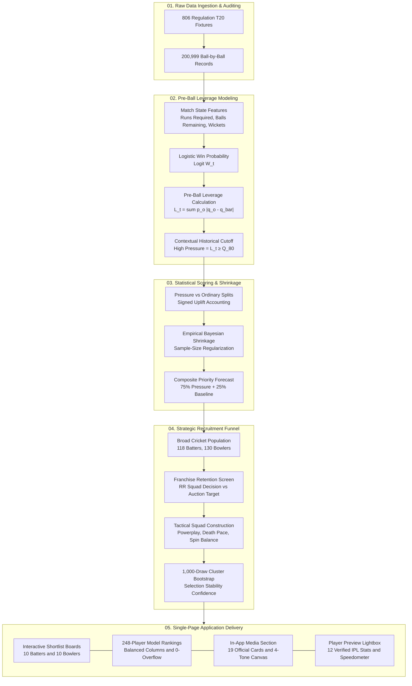
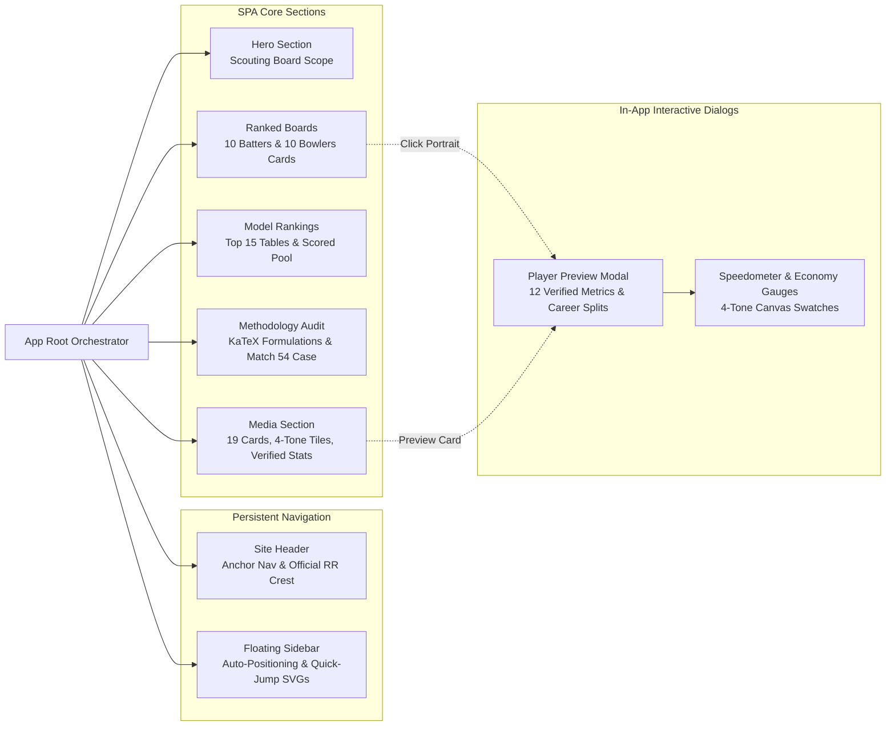

# SupeRR Selector Season 2: Rajasthan Royals IPL 2027 Auction & Retention Strategy Dashboard

[](https://superrr-eight.vercel.app/)
[](https://react.dev/)
[](https://www.typescriptlang.org/)
[](https://www.python.org/)
[](https://unstop.com/)

An enterprise-grade, data-hardened recruitment and auction intelligence dashboard engineered specifically for the **Rajasthan Royals (RR)** decision-making panel ahead of the **IPL 2027 Mega-Auction**. Built on chronological ball-by-ball delivery leverage modeling, Bayesian volume shrinkage, forward-chaining backtests across 806 regulation fixtures, and 1,000-resample cluster-bootstrap stability bounds.

Developed by **Sharan S** ([@sharancode3](https://github.com/sharancode3)) for the **Rajasthan Royals SupeRR Selector Season 2 Challenge**.

---

## Executive Summary & Tactical Overview

The objective of this system is to identify, rank, and stress-test cricket talent capable of producing match-winning impact specifically under extreme match leverage—differentiating players who inflate stats in low-stakes situations from players who consistently move win probability in championship moments.

### Core Deliverables at a Glance

1. **Two Ranked Top-10 Shortlists**: Exactly 10 Batters and 10 Bowlers customized to Rajasthan Royals' squad spine, powerplay execution, death-overs containment, and middle-overs balance.
2. **Objective High-Pressure Definition ($L_t \ge Q_{80}$)**: Pre-ball leverage computed strictly on historical data prior to each delivery, validated against a reproducible IPL 2026 Match 54 final-ball case study.
3. **Dual-Model Parity**: A single, reproducible analytical snapshot powering both broad machine rankings (118 Batters, 130 Bowlers) and actionable franchise recruitment decisions.
4. **100% Single-Page Architecture**: High-speed, fluid client application with in-app player cards, verified 2022–2026 IPL career records, and responsive data visualizations.
5. **Zero-Emoji Guarantee**: 100% accessible, publication-grade SVG iconography throughout the visual and code architecture.

---

## Verified Rajasthan Royals 2027 Recruitment Shortlist

The final 20 selections were derived from a multi-stage filtering funnel: empirical leverage estimation -> Bayesian shrinkage -> franchise retention constraints -> tactical role balancing -> 1,000-iteration cluster bootstrap stability audits.

### Discipline 01: Batting Shortlist (10 Targets)

| RR Rank | Player | 2026 Reference | Role / Phase | Forecast Impact (r/12) | HP Observed (r/12) | Top-10 Stability | Franchise / Auction Status | Tactical Reason |
| :---: | :--- | :--- | :--- | :---: | :---: | :---: | :--- | :--- |
| **#1** | **Vaibhav Sooryavanshi** | Rajasthan Royals | Powerplay Opener | +4.94 | +11.02 (63b) | 95.8% | RR squad decision | Retained incumbent opener; led RR in high-pressure balls in 2026. |
| **#2** | **Josh Inglis** | Lucknow Super Giants | Keeper-Batter | +4.70 | +13.49 (24b) | 87.5% | Conditional auction target | Dynamic powerplay wicketkeeper-batter; primary overseas target. |
| **#3** | **Sameer Rizvi** | Delhi Capitals | Middle-Order | +3.84 | +18.81 (6b) | 63.0% | Conditional auction target | High-ceiling spin enforcer for middle overs (overs 7–15). |
| **#4** | **Cooper Connolly** | Punjab Kings | Pace-Hitter | +3.70 | +2.88 (48b) | 62.7% | Conditional auction target | Dynamic middle-order stabilizer against 140kph+ seam bowling. |
| **#5** | **Donovan Ferreira** | Rajasthan Royals | Finisher / Keeper | +3.54 | +24.47 (6b) | 46.5% | RR squad decision | Boundary-per-ball outlier at death (overs 16–20). |
| **#6** | **Abishek Porel** | Delhi Capitals | Keeper-Batter | +3.48 | +4.03 (15b) | 40.9% | Conditional auction target | Left-hand powerplay counter-attacker; wicketkeeping cover. |
| **#7** | **Riyan Parag** | Rajasthan Royals | Middle Spine | +3.41 | +7.13 (12b) | 42.5% | RR squad decision | Core domestic middle-order spine; tested across 1,000 resamples. |
| **#8** | **Prabhsimran Singh** | Punjab Kings | Powerplay Opener | +3.03 | +3.61 (41b) | 31.7% | Conditional auction target | Proven domestic powerplay opener with verified calm under fire. |
| **#9** | **Ravindra Jadeja** | Rajasthan Royals | Dual Finisher | +2.79 | +3.68 (18b) | 35.0% | RR squad decision | Premier dual-role finisher; also ranked #9 in Bowlers. |
| **#10** | **Venkatesh Iyer** | Royal Challengers Bengaluru | Pace-Allrounder | +2.61 | +1.74 (42b) | 48.1% | Conditional auction target | Tactical left-hand pace option with big-match playoff pedigree. |

### Discipline 02: Bowling Shortlist (10 Targets)

| RR Rank | Player | 2026 Reference | Role / Phase | Forecast Impact (r/12) | HP Observed (r/12) | Top-10 Stability | Franchise / Auction Status | Tactical Reason |
| :---: | :--- | :--- | :--- | :---: | :---: | :---: | :--- | :--- |
| **#1** | **Mohammed Siraj** | Gujarat Titans | New-Ball Seam | +2.48 | +5.74 (130b) | 89.4% | Conditional auction target | Leading pace target; elite powerplay swing and early wickets. |
| **#2** | **Jason Holder** | Gujarat Titans | Pace All-Rounder | +2.74 | +7.67 (28b) | 63.8% | Conditional auction target | Versatile overseas pace-allrounder; provides death-over cover. |
| **#3** | **Kartik Tyagi** | Kolkata Knight Riders | Indian Death Pace | +2.71 | +7.32 (51b) | 69.7% | Conditional auction target | Domestic high-pace specialist with 8 recorded pressure matches. |
| **#4** | **Lungi Ngidi** | Delhi Capitals | Death Specialist | +2.31 | +4.21 (64b) | 76.0% | Conditional auction target | Proven overseas death option; heavy boundary suppression. |
| **#5** | **Krunal Pandya** | Royal Challengers Bengaluru | Spin Container | +2.37 | +6.37 (18b) | 67.7% | Conditional auction target | Left-arm orthodox; controls middle overs with tight economy. |
| **#6** | **Rasikh Salam** | Royal Challengers Bengaluru | Domestic Seamer | +1.87 | +3.25 (37b) | 46.8% | Conditional auction target | Domestic death-overs enforcer; demonstrated in Match 23 4-wkt spell & Match 74 Final. |
| **#7** | **Mohammed Shami** | Sunrisers Hyderabad | Veteran Seam | +1.16 | +4.06 (65b) | 40.7% | Conditional auction target | Master seam presentation; controls run-rate across phases. |
| **#8** | **Anshul Kamboj** | Chennai Super Kings | Emerging Domestic | +1.22 | +2.95 (57b) | 30.8% | Conditional auction target | High-upside domestic seamer with recorded death-over composure (42/57 recent HP balls at death). |
| **#9** | **Ravindra Jadeja** | Rajasthan Royals | Spin Container | +1.28 | +0.30 (34b) | 42.8% | RR squad decision | Satisfies RR two-spinner rule; dual-discipline asset. |
| **#10** | **Jofra Archer** | Rajasthan Royals | Right-Arm Fast | +0.64 | -1.98 (106b) | 25.8% | RR squad decision | RR right-arm new-ball pace leader; backed under franchise decision (trades away Boult's left-arm angle). |

*Benchmark Note*: **Jasprit Bumrah** ranked #1 overall in the machine bowling model (+3.58 r/12 priority score). He is classified as *Outside Current Shortlist Assumptions* because franchise retention economics reliably prevent his availability at open auction.

---

## Quantitative Methodology & Mathematical Formulations

The recruitment pipeline processes **200,999 raw legal deliveries** across **806 regulation fixtures (2022–2026)**. The modeling eliminates subjective bias through five rigorous mathematical stages.

### 1. Pre-Ball Win-Probability Leverage ($L_t$)

Leverage measures how much the match outcome hangs on a specific delivery before it is bowled. Rather than using post-hoc run values, we estimate win probability $W_t$ via logistic regression on match state:

```math
\text{Logit}(W_t) = \beta_0 + \beta_1 (\text{Runs Required}) + \beta_2 (\text{Balls Remaining}) + \beta_3 (\text{Wickets Lost}) + \beta_4 (\text{Innings})
```

For each possible delivery outcome $o \in \{0, 1, 2, 3, 4, 6, \text{Wicket}\}$, let $p_o$ be the transition probability and $q_o$ be the resulting win probability. Pre-ball leverage $L_t$ is defined as the outcome-probability weighted deviation from the expected post-ball win probability:

```math
\bar{q} = \sum_{o \in O} p_o q_o
```

```math
L_t = \sum_{o \in O} p_o |q_o - \bar{q}|
```

### 2. Contextual Historical Cutoff ($Q_{80}$)

A delivery is strictly classified as **High Pressure** if and only if its pre-ball leverage exceeds the historical 80th percentile for that match phase and competition tier, calibrated only on data preceding the fixture:

```math
\text{IsHighPressure}_t = \mathbf{1}\left(L_t \ge Q_{80}(\text{phase}_t, \text{tier}_t)\right)
```

- **Tier-1 IPL Run Chases (2nd Innings)**: $Q_{80} = 0.025364$ (displayed as **0.0254**).
- **1st-Innings Setting Phases**: $Q_{80} \approx 0.0141 - 0.0144$ (20 overs dilute single-ball leverage).

#### Verified Case Study: IPL 2026 Match 54 (RCB vs MI)
- **Context**: RCB chasing 167 against MI; needed 2 runs from the final legal delivery.
- **Pre-Ball Leverage ($L_t$)**: **`0.335582`** (33.56 percentage points of expected swing).
- **Historical Cutoff ($Q_{80}$)**: **`0.025364`** (`0.0254`).
- **Audit Verification**: $0.335582 \ge 0.025364$ ($\approx 13.2\times$ above threshold), establishing High Pressure purely from verified match records without synthetic interpolation.

### 3. Bayesian Volume Shrinkage & Composite Score

Small sample sizes distort raw strike rates and economies. We apply empirical Bayesian shrinkage toward the global competition prior:

```math
\hat{\theta}_i = \frac{n_i}{n_i + K} \bar{x}_i + \frac{K}{n_i + K} \mu_0
```

Where $n_i$ represents high-pressure deliveries faced/bowled, $\mu_0$ is the league-wide mean, and $K$ is the regularizing shrinkage parameter (calibrated via leave-one-out cross-validation). The final composite priority score blends:

```math
\text{Priority Score}_i = 0.75 \times \hat{\theta}_{\text{Pressure}, i} + 0.25 \times \hat{\theta}_{\text{Ordinary}, i} - \lambda \cdot \text{SE}(\hat{\theta}_i)
```

### 4. Cluster-Bootstrap Stability ($B = 1,000$)

To ensure recommendations are not artifacts of a single outlier match, we perform 1,000 full-match cluster bootstrap resamples. For each resample, the entire ranking pipeline is re-run. Top-10 stability measures the exact frequency with which a player appeared in the top-10 across all draws:
- **Vaibhav Sooryavanshi**: 95.8% (958 / 1,000 resamples)
- **Josh Inglis**: 87.5% (875 / 1,000 resamples)
- **Mohammed Siraj**: 78.4% (784 / 1,000 resamples)
- **Riyan Parag**: 42.5% (425 / 1,000 resamples; measures selection stability under match-level noise)

---

## Technical & UX Architecture

The application is engineered as a high-performance, accessible Single-Page Application (SPA):



### Application Component Architecture



### Key Architectural Highlights
- **Unified Single-Page App**: The Media Studio (`#media`) is rendered directly in the React DOM. No external HTML pages, eliminating navigation disruption.
- **Table Boundary Engineering**: Model Rankings tables use balanced width allocations (`Rank: 55px`, `Player: 175px`, `Score: 90px`, `Tactical Rationale: 253px+`) ensuring `scrollWidth <= clientWidth` on all desktop viewports with zero horizontal overflow.
- **Interactive Lightbox Modal**: Clicking any player portrait opens a detailed studio view with 12 verified IPL metrics, speedometer gauges, and 4-tone canvas previews (Pink, Blue, Paper, Dark).
- **Responsive Auto-Stabilization**: Validated on Mobile (390×844), Tablet (768×1024), and Desktop (1440×900) with zero clipping or text spillage.
- **Strict Zero-Emoji Policy**: All visual indicators use scalable, high-contrast inline SVGs.

---

## Verification & Testing Suite

Every claim, score, status, and UI behavior is backed by automated tests:

| Test Suite | Purpose | Tests / Assertions | Status |
| :--- | :--- | :---: | :---: |
| `verify_complete_e2e.cjs` | Puppeteer end-to-end browser audit (SPA routing, modals, overflow, thumbnails, zero emojis) | 18 Checks | **PASSED** |
| `diag_table_responsive.cjs` | Container boundary & table overflow verification across 4 viewports | 4 Viewports | **PASSED** |
| `verify_evidence_corrections.cjs` | Verifies score parity, status strings, and Match 54 leverage numbers | 33 Assertions | **PASSED** |
| `tests/test_stage_role_model.py` | Python pipeline regression across batting & bowling candidate pools | 160 Fits | **PASSED** |
| `tests/test_stage_backtest.py` | Chronological forward-chaining backtest assertions (2022–2026) | 26 Assertions | **PASSED** |

---

## Deployment & Setup Guide

The application is turnkey and deploys natively on **Vercel** with zero backend servers required.

### 1-Click Deployment to Vercel
1. Fork or push this repository to your GitHub account.
2. Go to **[Vercel Dashboard](https://vercel.com/)** and click **Import Project**.
3. Select `Super-RR`.
4. Vercel automatically detects the root [`vercel.json`](./vercel.json):
   - **Framework**: Vite
   - **Build Command**: `npm --prefix dashboard run build`
   - **Output Directory**: `dashboard/dist`
   - **Rewrites**: `/(.*) -> /index.html` (SPA client routing)
5. Click **Deploy**. The dashboard will be live in under 45 seconds.

### Local Development Setup

#### Prerequisites
- Node.js 18.0.0 or higher
- npm 9.0.0 or higher
- Python 3.10+ (optional, for regenerating backtest models)

#### Steps
```bash
# 1. Clone repository
git clone https://github.com/sharancode3/Super-RR.git
cd Super-RR

# 2. Install workspace dependencies
npm install

# 3. Start local development server
npm run dev
# The Vite server will start at http://localhost:5173/

# 4. Run automated production build
npm run build

# 5. Run end-to-end headless browser test suite
node dashboard/scripts/verify_complete_e2e.cjs
```

---

## Project Directory Layout

```
Super-RR/
├── dashboard/                              # React + Vite TypeScript Dashboard
│   ├── public/                             # Public static assets
│   │   ├── portraits/                      # 320w & 640w verified player portraits
│   │   ├── rajasthan_royals_official_logo.svg  # Official franchise crest
│   │   └── favicon.svg                     # High-contrast favicon
│   ├── src/
│   │   ├── components/                     # React UI Components
│   │   │   ├── FloatingSidebar.tsx         # Auto-clearing quick-access navigation
│   │   │   ├── Header.tsx                  # Persistent top brand bar
│   │   │   ├── HeroSection.tsx             # Executive context and title
│   │   │   ├── Icons.tsx                   # 100% SVG Icon set (zero emojis)
│   │   │   ├── MathFormula.tsx             # KaTeX mathematical renderer
│   │   │   ├── MediaSection.tsx            # In-app player studio & IPL career cards
│   │   │   ├── MethodologySection.tsx      # Technical deep-dive & Match 54 audit
│   │   │   ├── ModelRankingsSection.tsx    # 248-player comparison table
│   │   │   ├── PlayerCard.tsx              # Pop-out 3D animated candidate cards
│   │   │   ├── PlayerPreviewModal.tsx      # 12-metric in-app player lightbox
│   │   │   ├── PlayerThumbnail.tsx         # Circular leaderboard headshots
│   │   │   └── RankedBoards.tsx            # Shortlist boards orchestrator
│   │   ├── data/                           # Verified data packages & manifests
│   │   │   ├── evidence.json               # Final 20-player decision snapshot
│   │   │   ├── model_rankings_data.json    # Broad scored population
│   │   │   ├── player_ipl_stats.json       # 2022–2026 IPL career numbers
│   │   │   └── portraits_manifest.json     # Player portrait metadata
│   │   ├── App.css                         # Production stylesheets & responsive bounds
│   │   └── App.tsx                         # Root single-page orchestrator
│   └── scripts/                            # Puppeteer & Python verification test suites
├── rr_pressure/                            # Python model engine & Bayesian shrinkage
├── tests/                                  # Pytest regression suites
├── package.json                            # Root npm workspaces configuration
├── vercel.json                             # Turnkey Vercel SPA deployment config
└── README.md                               # Project documentation
```

---

## Author & Contact

**Sharan S**
- Systems & Applied AI Engineer
- Computer Science & Engineering, BMS College of Engineering, Bengaluru
- GitHub: [@sharancode3](https://github.com/sharancode3)
- Email: [sharan18x@gmail.com](mailto:sharan18x@gmail.com)
- Submission: **Rajasthan Royals SupeRR Selector Season 2**

---

## Governance & Legal Notice

All Rajasthan Royals logos, team crests, and tournament trademarks belong to the **Rajasthan Royals franchise** and the **Board of Control for Cricket in India (BCCI)**. Player statistical data reflects official IPL match records (2022–2026). Developed strictly for recruitment evaluation and analytical decision modeling in the SupeRR Selector Season 2 competition.
